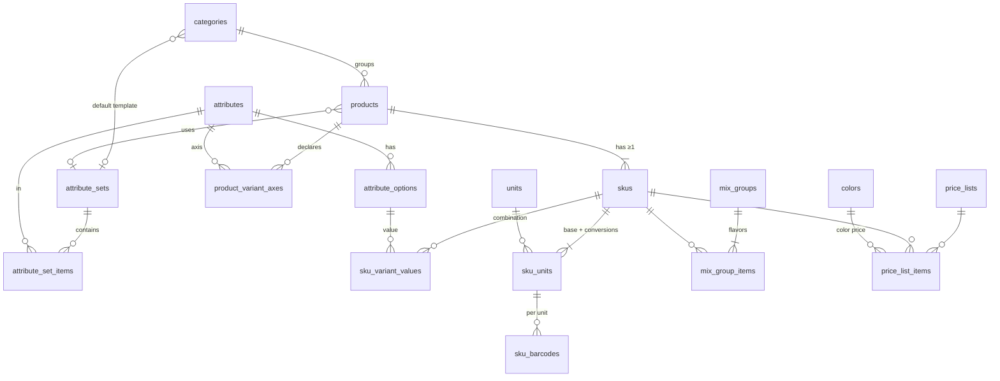

# Brainstorm — Thiết kế cơ sở dữ liệu, trọng tâm Danh mục hàng hóa động

- Ngày: 2026-10-16
- Nguồn: `prd.md` bản 1.1 (CAT-01..11, PRC-01..08, INV-01..12, mục 7.3–7.10, mục 10, mục 12), bản mẫu tương tác v6.14 (artifact `3Kg9zruBj5QNFNMbVcpqyo`, mô hình `S.products`, `S.mixGroups`, `S.lots`).
- Quyết định của người dùng trong phiên: thuộc tính tùy biến + biến thể SKU; PostgreSQL; màu là bảng tra cứu seed 7 màu; thiết kế toàn bộ schema nhưng đi sâu ở Danh mục & Giá.

## 1. Brainstorm contract

**Outcome.** Một thiết kế schema PostgreSQL cho toàn bộ sản phẩm Tết Sales Management, trong đó chủ cửa hàng tự quản lý cấu trúc hàng hóa mà không cần migration: tự định nghĩa thuộc tính, gom thành mẫu ngành, gắn vào nhóm hàng, khai báo trục biến thể để sinh SKU con có tồn riêng. Các domain khác (kho, nhập, bán, giỏ quà, công nợ, tiền) có bảng và bất biến đủ rõ để lập kế hoạch triển khai.

**Constraints.**
- Stack: Go, gin (HTTP), sqlx, golang-migrate, cobra; React, Vite, Tailwind, shadcn/ui, TanStack Query; PostgreSQL ≥ 15 (đã xác nhận; dùng `UNIQUE NULLS NOT DISTINCT`).
- SaaS đa tenant: không có tham chiếu nào nối được dữ liệu hai tenant (PRD mục 10, NFR-01).
- Một cửa hàng, một kho, nhưng vẫn lưu `warehouse_id` (ORG-03).
- Màu là thuộc tính của **lô**, không phải biến thể: giá vốn và giữ hàng không tách theo màu (mục 7.4, 7.5, 7.9).
- Tiền và số lượng là decimal, không float; dòng chứng từ snapshot giá, đơn vị, hệ số (mục 7.3).
- Chứng từ đã ghi sổ không sửa/xóa; dùng đảo/điều chỉnh (mục 7.8). Ghi sổ nguyên tử, idempotent (NFR-02).
- Tải chuẩn: 20.000 SKU, 1.000.000 dòng chuyển động/tenant; tra cứu p95 ≤ 1 giây (NFR-03, NFR-04).
- Không đưa lại các chức năng đã bỏ ở bản 1.1 (mục 2.5).

**Non-goals.**
- Viết code, migration thật hoặc thiết kế màn hình.
- Tổng quát hóa chiều tồn ngoài màu (kích cỡ, chất liệu trên lô) — người dùng đã chọn không làm.
- Mở UI cho chủ cửa hàng tự thêm màu (chờ OPEN-21); schema chỉ chuẩn bị sẵn.
- Đặc tả chi tiết POS offline, job tính lại giá vốn, billing SaaS.

**Acceptance criteria (chứng minh ở giai đoạn triển khai).**
1. Chủ cửa hàng tạo thuộc tính mới (ví dụ “Xuất xứ”, kiểu chọn), gắn vào mẫu ngành, tạo hàng có giá trị đó và lọc danh sách theo nó, không có migration nào chạy.
2. Sản phẩm có trục biến thể (ví dụ Vị × Trọng lượng) sinh đúng các SKU con; tạo trùng một tổ hợp bị database từ chối.
3. Mỗi SKU có đơn vị cơ sở và quy đổi; mã vạch theo từng đơn vị là duy nhất trong tenant; đổi hệ số không làm đổi dòng chứng từ cũ.
4. Hàm tra giá trả về đúng một giá kèm nguồn giá cho (khách, SKU, màu, đơn vị, số lượng, ngày); giá theo màu ghi đè giá chung; mọi lần đổi giá có dòng lịch sử ghi nơi sửa, người sửa, giá cũ → mới.
5. Bất biến kho: với mọi SKU, tổng `stock_moves` theo từng màu bằng tổng `lot_balances` của màu đó; lệnh `tally ledger verify` báo khớp.
6. Kiểm thử tự động với hai tenant: không đọc/ghi/tham chiếu chéo được, cả ở tầng ứng dụng lẫn RLS.
7. Tìm không dấu theo tên/mã/mã vạch/tên vị đạt p95 ≤ 1 giây với 20.000 SKU.
8. `tally migrate up` / `down` chạy sạch; tạo tenant mới tự seed 7 màu, đơn vị phổ biến và mẫu ngành.

## 2. Các phương án lưu thuộc tính động

| | A. Hybrid (đề xuất) | B. EAV có kiểu | C. JSONB thuần |
|---|---|---|---|
| Định nghĩa thuộc tính | Bảng quan hệ | Bảng quan hệ | JSON trong bảng cấu hình |
| Giá trị mô tả | `products.attributes JSONB`, khóa = mã thuộc tính, giá trị chọn lưu option id | Bảng `attribute_values` với cột text/number/bool/option | JSONB |
| Giá trị trục biến thể | Bảng `sku_variant_values` + `variant_key` duy nhất | Bảng EAV | JSONB |
| Lọc nhiều thuộc tính | Một điều kiện `@>` dùng GIN | N lần self-join | `@>` dùng GIN |
| Toàn vẹn biến thể | Database bảo đảm | Database bảo đảm | Chỉ ứng dụng |

**Trade-offs.**
- **A — Hybrid.** Phụ thuộc nhất vào giả định: mọi thao tác ghi đi qua một service Go duy nhất để kiểm tra JSONB theo định nghĩa. Hỏng đầu tiên khi: một thuộc tính mô tả cần toàn vẹn quan hệ hoặc tổng hợp nặng trên báo cáo 1 triệu dòng; khi đó nâng thuộc tính đó thành cột hoặc expression index. Tình huống xấu nhất: option id trong JSONB trỏ tới option đã xóa — chặn bằng quy tắc “đã dùng thì chỉ ngừng, không xóa”.
- **B — EAV.** Phụ thuộc vào giả định: mỗi truy vấn chỉ lọc ít thuộc tính. Hỏng đầu tiên ở màn danh sách có nhiều bộ lọc: số join tăng theo số bộ lọc, sqlx phải scan vào cấu trúc động, code truy vấn phức tạp. Tình huống xấu nhất vẫn đúng dữ liệu nhưng chậm và khó bảo trì.
- **C — JSONB thuần.** Phụ thuộc vào giả định: không cần database chặn trùng biến thể. Hỏng đầu tiên khi hai thiết bị cùng sinh biến thể hoặc đổi tên option: sinh SKU trùng tổ hợp, chuỗi giá trị mồ côi. Sổ kho vốn đã tham chiếu SKU dạng dòng, nên biến thể buộc phải là bảng — C không bỏ được bảng SKU.

**Đề xuất: A.** Đây cũng là phương án rẻ nhất để đổi hướng: bảng định nghĩa dùng chung cho cả A và B, nên nếu sau này cần EAV chỉ phải viết một script chuyển JSONB sang bảng giá trị.

**Better approaches:** none — hướng đề xuất trùng hướng người dùng đã chọn (thuộc tính tùy biến + biến thể SKU; bằng chứng: CAT-01 “biến thể”, CAT-04 “bộ thuộc tính và mẫu ngành… không dùng thuộc tính thay SKU khi cần tồn độc lập”).

## 3. Quy ước chung cho mọi bảng

- Khóa chính `id uuid` (UUIDv7 sinh trong Go, có thứ tự thời gian, tốt cho index) và `tenant_id uuid NOT NULL`.
- Mọi bảng nghiệp vụ có `UNIQUE (tenant_id, id)`; mọi khóa ngoại là **khóa ngoại kép** `(tenant_id, x_id) REFERENCES x (tenant_id, id)`. Database không cho phép một dòng trỏ sang tenant khác.
- RLS bật và `FORCE` trên mọi bảng nghiệp vụ: `USING (tenant_id = current_setting('app.tenant_id')::uuid)`. Ứng dụng kết nối bằng role không phải owner; mỗi request mở transaction và chạy `set_config('app.tenant_id', $1, true)`.
- Tiền: `numeric(19,4)`; số lượng: `numeric(18,4)`; hệ số quy đổi: `numeric(18,6)`. Go dùng `shopspring/decimal`; làm tròn VND tại ranh giới đã định.
- Thời gian: `created_at timestamptz` (UTC) và `business_date date` theo timezone tenant trên chứng từ.
- Bảng có sửa đổi có `version int` cho optimistic locking. Chứng từ ghi sổ có `idempotency_key`, `posted_at`, `posted_by`, `reversal_of`.
- Trạng thái lưu bằng `text` + `CHECK`, không dùng PostgreSQL enum (thêm giá trị không cần `ALTER TYPE`).

## 4. Danh mục & Giá — thiết kế chi tiết

### 4.1. Mô hình khái niệm



- **Product** là mặt hàng: tên, nhóm, loại, thuộc tính mô tả, ảnh, trạng thái. Không tham gia sổ kho.
- **SKU** là đơn vị quản lý tồn: mọi chứng từ, lô, chuyển động, giữ hàng, giá vốn đều tham chiếu `sku_id`. Hàng đơn giản có đúng một SKU với `variant_key = ''`; UI ẩn khái niệm này.
- **Màu** không phải trục biến thể. Màu nằm trên lô và dòng chứng từ; giá theo màu nằm trong bảng giá. Thuộc tính động dành cho mọi thứ khác (vị, trọng lượng, thương hiệu, xuất xứ…).

### 4.2. DDL phác thảo

```sql
-- Bảng tra cứu theo tenant
CREATE TABLE colors (
  id uuid PRIMARY KEY, tenant_id uuid NOT NULL,
  code text NOT NULL, name text NOT NULL, hex char(7) NOT NULL,
  sort_order int NOT NULL DEFAULT 0, is_system bool NOT NULL DEFAULT false,
  active bool NOT NULL DEFAULT true,
  UNIQUE (tenant_id, id), UNIQUE (tenant_id, code)
);  -- seed: xanh, do, tim, vang, nau, den, trang (is_system = true)

CREATE TABLE units (
  id uuid PRIMARY KEY, tenant_id uuid NOT NULL,
  name text NOT NULL, active bool NOT NULL DEFAULT true,
  UNIQUE (tenant_id, id)
);
CREATE UNIQUE INDEX ON units (tenant_id, lower(name));

-- Định nghĩa thuộc tính động
CREATE TABLE attributes (
  id uuid PRIMARY KEY, tenant_id uuid NOT NULL,
  code text NOT NULL,                       -- khóa trong JSONB, bất biến sau khi tạo
  name text NOT NULL,
  data_type text NOT NULL CHECK (data_type IN ('text','number','boolean','date','select','multiselect')),
  unit_label text,                          -- ví dụ 'g', 'ml' cho kiểu number
  is_filterable bool NOT NULL DEFAULT false,
  is_searchable bool NOT NULL DEFAULT false,
  status text NOT NULL DEFAULT 'active' CHECK (status IN ('active','inactive')),
  UNIQUE (tenant_id, id), UNIQUE (tenant_id, code)
);

CREATE TABLE attribute_options (
  id uuid PRIMARY KEY, tenant_id uuid NOT NULL, attribute_id uuid NOT NULL,
  label text NOT NULL, sort_order int NOT NULL DEFAULT 0, active bool NOT NULL DEFAULT true,
  UNIQUE (tenant_id, id), UNIQUE (tenant_id, attribute_id, label),
  FOREIGN KEY (tenant_id, attribute_id) REFERENCES attributes (tenant_id, id)
);

CREATE TABLE attribute_sets (               -- "mẫu ngành": Bánh kẹo, Đồ uống, Giỏ quà…
  id uuid PRIMARY KEY, tenant_id uuid NOT NULL, name text NOT NULL,
  active bool NOT NULL DEFAULT true,
  UNIQUE (tenant_id, id), UNIQUE (tenant_id, name)
);

CREATE TABLE attribute_set_items (
  tenant_id uuid NOT NULL, attribute_set_id uuid NOT NULL, attribute_id uuid NOT NULL,
  is_required bool NOT NULL DEFAULT false, sort_order int NOT NULL DEFAULT 0,
  PRIMARY KEY (tenant_id, attribute_set_id, attribute_id),
  FOREIGN KEY (tenant_id, attribute_set_id) REFERENCES attribute_sets (tenant_id, id),
  FOREIGN KEY (tenant_id, attribute_id) REFERENCES attributes (tenant_id, id)
);

CREATE TABLE categories (
  id uuid PRIMARY KEY, tenant_id uuid NOT NULL, parent_id uuid,
  name text NOT NULL, attribute_set_id uuid, sort_order int NOT NULL DEFAULT 0,
  active bool NOT NULL DEFAULT true,
  UNIQUE (tenant_id, id),
  FOREIGN KEY (tenant_id, parent_id) REFERENCES categories (tenant_id, id),
  FOREIGN KEY (tenant_id, attribute_set_id) REFERENCES attribute_sets (tenant_id, id)
);

-- Mặt hàng và SKU
CREATE TABLE products (
  id uuid PRIMARY KEY, tenant_id uuid NOT NULL,
  type text NOT NULL CHECK (type IN ('goods','material','kit','combo')),
  name text NOT NULL, category_id uuid, attribute_set_id uuid,
  attributes jsonb NOT NULL DEFAULT '{}' CHECK (jsonb_typeof(attributes) = 'object'),
  status text NOT NULL DEFAULT 'active' CHECK (status IN ('draft','active','inactive')),
  version int NOT NULL DEFAULT 1, created_at timestamptz NOT NULL DEFAULT now(),
  updated_at timestamptz NOT NULL DEFAULT now(),
  UNIQUE (tenant_id, id),
  FOREIGN KEY (tenant_id, category_id) REFERENCES categories (tenant_id, id),
  FOREIGN KEY (tenant_id, attribute_set_id) REFERENCES attribute_sets (tenant_id, id)
);
CREATE INDEX ON products USING gin (attributes jsonb_path_ops);
CREATE UNIQUE INDEX ON products (tenant_id, lower(name));        -- CAT-11 chặn trùng tên

CREATE TABLE product_variant_axes (
  tenant_id uuid NOT NULL, product_id uuid NOT NULL, attribute_id uuid NOT NULL,
  position smallint NOT NULL,
  PRIMARY KEY (tenant_id, product_id, attribute_id),
  UNIQUE (tenant_id, product_id, position),
  FOREIGN KEY (tenant_id, product_id) REFERENCES products (tenant_id, id),
  FOREIGN KEY (tenant_id, attribute_id) REFERENCES attributes (tenant_id, id)
);  -- chỉ thuộc tính kiểu select; khóa trục khi bất kỳ SKU nào của product đã có chuyển động kho

CREATE TABLE skus (
  id uuid PRIMARY KEY, tenant_id uuid NOT NULL, product_id uuid NOT NULL,
  code text NOT NULL,                       -- mã SKU, duy nhất trong tenant
  variant_key text NOT NULL DEFAULT '',     -- option id các trục, sắp theo position, nối bằng '|'
  display_name text NOT NULL,               -- "Sữa TH 180ml – Dâu", sinh khi lưu
  base_unit_id uuid NOT NULL,
  qty_scale smallint NOT NULL DEFAULT 0 CHECK (qty_scale BETWEEN 0 AND 4),  -- 0 = bắt buộc số nguyên
  track_lot bool NOT NULL DEFAULT false, track_expiry bool NOT NULL DEFAULT false,
  ref_cost numeric(19,4),                   -- giá mua tham khảo, không phải giá vốn
  min_price numeric(19,4),                  -- một mức chung (OPEN-19)
  min_stock numeric(18,4) NOT NULL DEFAULT 0,
  status text NOT NULL DEFAULT 'active' CHECK (status IN ('active','inactive')),
  search_norm text NOT NULL DEFAULT '',     -- chuỗi không dấu do Go chuẩn hóa
  version int NOT NULL DEFAULT 1,
  UNIQUE (tenant_id, id), UNIQUE (tenant_id, code),
  UNIQUE (tenant_id, product_id, variant_key),
  FOREIGN KEY (tenant_id, product_id) REFERENCES products (tenant_id, id),
  FOREIGN KEY (tenant_id, base_unit_id) REFERENCES units (tenant_id, id)
);
CREATE INDEX ON skus USING gin (search_norm gin_trgm_ops);

CREATE TABLE sku_variant_values (
  tenant_id uuid NOT NULL, sku_id uuid NOT NULL, attribute_id uuid NOT NULL, option_id uuid NOT NULL,
  PRIMARY KEY (tenant_id, sku_id, attribute_id),
  FOREIGN KEY (tenant_id, sku_id) REFERENCES skus (tenant_id, id),
  FOREIGN KEY (tenant_id, option_id) REFERENCES attribute_options (tenant_id, id)
);

CREATE TABLE sku_units (
  tenant_id uuid NOT NULL, sku_id uuid NOT NULL, unit_id uuid NOT NULL,
  factor numeric(18,6) NOT NULL CHECK (factor > 0),   -- 1 đơn vị này = factor đơn vị cơ sở
  is_base bool NOT NULL DEFAULT false, active bool NOT NULL DEFAULT true,
  PRIMARY KEY (tenant_id, sku_id, unit_id),
  CHECK (NOT is_base OR factor = 1),
  FOREIGN KEY (tenant_id, sku_id) REFERENCES skus (tenant_id, id),
  FOREIGN KEY (tenant_id, unit_id) REFERENCES units (tenant_id, id)
);
CREATE UNIQUE INDEX ON sku_units (tenant_id, sku_id) WHERE is_base;

CREATE TABLE sku_barcodes (
  id uuid PRIMARY KEY, tenant_id uuid NOT NULL, sku_id uuid NOT NULL, unit_id uuid NOT NULL,
  code text NOT NULL,
  UNIQUE (tenant_id, code),
  FOREIGN KEY (tenant_id, sku_id, unit_id) REFERENCES sku_units (tenant_id, sku_id, unit_id)
);

CREATE TABLE product_images (
  id uuid PRIMARY KEY, tenant_id uuid NOT NULL, product_id uuid NOT NULL, sku_id uuid,
  storage_key text NOT NULL, sort_order int NOT NULL DEFAULT 0,
  FOREIGN KEY (tenant_id, product_id) REFERENCES products (tenant_id, id)
);

-- Nhóm mix vị (CAT-10, mục 7.10)
CREATE TABLE mix_groups (
  id uuid PRIMARY KEY, tenant_id uuid NOT NULL, name text NOT NULL,
  pack_unit_id uuid NOT NULL, units_per_pack int NOT NULL,   -- 1 thùng = 48 hộp
  part_unit_id uuid NOT NULL, units_per_part int NOT NULL,   -- 1 dây = 4 hộp
  status text NOT NULL DEFAULT 'active' CHECK (status IN ('active','inactive')),
  UNIQUE (tenant_id, id),
  CHECK (units_per_part > 0 AND units_per_pack % units_per_part = 0
         AND units_per_pack / units_per_part >= 2)
);
CREATE UNIQUE INDEX ON mix_groups (tenant_id, lower(name));

CREATE TABLE mix_group_items (
  tenant_id uuid NOT NULL, mix_group_id uuid NOT NULL, sku_id uuid NOT NULL,
  flavor_label text NOT NULL, sort_order int NOT NULL DEFAULT 0,
  PRIMARY KEY (tenant_id, mix_group_id, sku_id),
  FOREIGN KEY (tenant_id, mix_group_id) REFERENCES mix_groups (tenant_id, id),
  FOREIGN KEY (tenant_id, sku_id) REFERENCES skus (tenant_id, id)
);
```

### 4.3. Giá (PRC-01, 02, 07, 08)

```sql
CREATE TABLE price_lists (
  id uuid PRIMARY KEY, tenant_id uuid NOT NULL, name text NOT NULL,
  kind text NOT NULL CHECK (kind IN ('retail','wholesale','group','customer','season')),
  customer_group_id uuid, party_id uuid, campaign_id uuid,
  priority int NOT NULL DEFAULT 100, valid_from date, valid_to date,
  active bool NOT NULL DEFAULT true,
  UNIQUE (tenant_id, id)
);  -- seed: một bảng 'retail' và một bảng 'wholesale' cho mỗi tenant

CREATE TABLE price_list_items (
  id uuid PRIMARY KEY, tenant_id uuid NOT NULL, price_list_id uuid NOT NULL, sku_id uuid NOT NULL,
  color_id uuid,                    -- NULL = giá chung; có giá trị = giá riêng của màu
  unit_id uuid,                     -- NULL = theo đơn vị cơ sở
  min_qty numeric(18,4) NOT NULL DEFAULT 0,   -- bậc thang tính theo số lượng cơ sở
  price numeric(19,4) NOT NULL CHECK (price >= 0),
  UNIQUE NULLS NOT DISTINCT (tenant_id, price_list_id, sku_id, color_id, unit_id, min_qty),
  FOREIGN KEY (tenant_id, price_list_id) REFERENCES price_lists (tenant_id, id),
  FOREIGN KEY (tenant_id, sku_id) REFERENCES skus (tenant_id, id),
  FOREIGN KEY (tenant_id, color_id) REFERENCES colors (tenant_id, id)
);

CREATE TABLE price_changes (        -- append-only
  id uuid PRIMARY KEY, tenant_id uuid NOT NULL, price_list_id uuid NOT NULL, sku_id uuid NOT NULL,
  color_id uuid, unit_id uuid, min_qty numeric(18,4) NOT NULL,
  old_price numeric(19,4), new_price numeric(19,4),          -- NULL = thêm mới / "Bỏ giá riêng"
  source text NOT NULL CHECK (source IN ('catalog','purchase_order','product_list','inventory','price_list')),
  source_doc_id uuid, actor_id uuid NOT NULL, created_at timestamptz NOT NULL DEFAULT now()
);
```

**Thứ tự tra giá** (một hàm Go duy nhất, trả về giá và nguồn):
1. Ứng viên theo ưu tiên: bảng giá riêng của khách → bảng giá nhóm khách → bảng mùa/chiến dịch còn hiệu lực → bảng cơ sở (`retail` hoặc `wholesale` theo nhóm khách). Cùng cấp thì xét `priority`.
2. Trong bảng đầu tiên có dòng khớp: dòng có `color_id` khớp thắng dòng `color_id IS NULL`; dòng có `unit_id` khớp thắng giá theo đơn vị cơ sở × hệ số; `min_qty` lớn nhất ≤ số lượng cơ sở.
3. “Bỏ giá riêng” = xóa dòng màu và ghi `price_changes`. “Áp dụng cho tất cả màu” = xóa các dòng màu cùng SKU trong bảng đó trong cùng transaction.

### 4.4. Quy tắc sửa cấu trúc động

| Đối tượng | Cho phép | Chặn |
|---|---|---|
| Thuộc tính | Đổi tên, bật/tắt lọc, thêm option, ngừng dùng | Đổi `code` hoặc `data_type` khi đã có product dùng; xóa khi đã dùng |
| Option | Đổi nhãn (chứng từ giữ nhãn đã snapshot), ngừng dùng | Xóa khi còn product/SKU tham chiếu |
| Mẫu ngành | Thêm/bớt thuộc tính, đổi bắt buộc | Không tự xóa giá trị đã lưu trên product khi bớt thuộc tính (chỉ ẩn) |
| Trục biến thể | Thêm option mới để sinh SKU mới bất cứ lúc nào | Thêm/bớt trục khi SKU của product đã có chuyển động kho |
| SKU | Ngừng bán bất cứ lúc nào | Xóa khi đã có chứng từ; đổi `track_lot` khi còn tồn (CAT-03) |
| Quy đổi đơn vị | Đổi hệ số (dòng cũ giữ snapshot) | Đổi đơn vị cơ sở khi đã có chuyển động |
| Nhóm mix | Đổi tên, thêm vị | Đổi quy cách, gỡ vị đã bán, xóa khi đã dùng trên chứng từ (chỉ ngừng) |

Kiểm tra JSONB nằm ở một validator Go: khóa phải là `code` của thuộc tính thuộc mẫu ngành của product, giá trị đúng kiểu, option phải tồn tại và đang dùng (hoặc là giá trị cũ không đổi), đủ thuộc tính bắt buộc.

**Liên kết mix vị với biến thể.** Sữa TH 180ml có thể là một product với trục “Vị”; tạo nhóm mix từ product đó sẽ điền sẵn `mix_group_items` bằng các SKU biến thể và lấy nhãn option làm `flavor_label`. Nhóm mix vẫn chấp nhận SKU từ các product khác như PRD hiện tại.

**Tìm kiếm (CAT-08).** Go chuẩn hóa `search_norm` = tên product + nhãn biến thể + mã SKU + mọi mã vạch + nhãn vị, bỏ dấu (gồm đ → d), chữ thường. Tra mã vạch chính xác dùng unique index của `sku_barcodes`; tìm gần đúng dùng trigram. Thuộc tính `is_searchable` được nối vào `search_norm`.

## 5. Các domain khác — bảng và bất biến chính

| Domain | Bảng | Bất biến/ghi chú |
|---|---|---|
| Tổ chức & truy cập | `tenants`, `users`, `sessions`, `stores`, `warehouses`, `doc_sequences`, `idempotency_keys`, `audit_events`, `period_locks`, `exception_confirmations`, `attachments` | Số chứng từ cấp qua `doc_sequences` khóa dòng; `audit_events` append-only |
| Đối tác | `parties`, `customer_profiles`, `supplier_profiles`, `customer_groups`, `contacts` | Một party có hai profile nhưng hai sổ nợ tách biệt (CAT-06) |
| Kho | `lots`, `stock_moves`, `lot_balances`, `sku_stock`, `reservations`, `stock_counts` + `_lines`, `stock_adjustments` + `_lines` | Xem 5.1 |
| Nhập hàng | `purchase_orders` + `_lines`, `receipts` + `_lines`, `supplier_documents`, `purchase_returns` + `_lines`, `landed_cost_allocations` | Dòng nhận mang `color_id`, `lot_no`, `expiry`; trả NCC tham chiếu `receipt_line_id` |
| Bán hàng | `quotes` + `_lines`, `invoices` + `_lines` + `invoice_versions`, `stock_outs` + `_lines`, `pos_carts` + `_lines`, `sales_returns` + `_lines`, `exchanges` | `stock_outs` là thời điểm ghi doanh thu và phải thu; dòng mix có `mix_key`, `mix_group_id` |
| Giỏ quà | `kit_recipes` (version, status), `kit_recipe_items` (`color_id` cố định, `mix_group_id`), `assembly_orders`, `assembly_postings`, `lot_genealogy` | Product `type` = `kit` có tồn; `combo` không có lô |
| Công nợ | `obligations`, `obligation_settlements`, `payments`, `credit_notes`, `debt_adjustments`, `statements` + `statement_versions` | Dư nợ = nghĩa vụ − phân bổ; không có ô số dư nhập tay |
| Tiền (nền) | `fund_accounts` (2), `cash_entries`, `shifts` | Không có UI riêng |
| Chiến dịch & CRM | `campaigns`, `campaign_attributions`, `customer_activities`, `consents` | Một attribution chính trên dòng tài chính |
| Thông báo | `notifications` | Unique theo `dedupe_key` |
| SaaS | `plans`, `subscriptions`, `entitlements`, `saas_invoices`, `support_tickets`, `support_sessions` | Tách khỏi tài chính cửa hàng |

**Cột snapshot chung trên mọi dòng chứng từ hàng hóa:** `sku_id`, `sku_code_snap`, `name_snap`, `variant_label_snap`, `unit_id`, `unit_name_snap`, `unit_factor_snap`, `qty`, `base_qty` (generated = `qty * unit_factor_snap`), `color_id`, `unit_price`, `discount`, `spec_text`, `price_source jsonb`, `mix_key`, `mix_group_id`.

### 5.1. Sổ kho

- `lots (warehouse_id, sku_id, lot_no, expiry_date, color_id, is_quarantine)` — `UNIQUE NULLS NOT DISTINCT` trên bộ đó: cùng mã lô khác màu là hai lô; `color_id NULL` = chưa gán màu.
- `stock_moves` append-only: `lot_id`, `color_id` (lặp lại từ lô để báo cáo và kiểm tra bất biến), `qty` có dấu theo đơn vị cơ sở, `unit_cost`, `move_type`, `doc_type`, `doc_id`, `doc_line_id`, `business_date`, `posted_at`, `reversal_of`. Index `(tenant_id, sku_id, business_date, id)` phục vụ thẻ kho; `(tenant_id, doc_type, doc_id)` phục vụ truy ngược.
- `lot_balances (lot_id, qty)` và `sku_stock (warehouse_id, sku_id, on_hand, sellable, reserved, avg_cost, version)` là projection cập nhật trong cùng transaction ghi sổ, rebuild được bằng `tally ledger rebuild`.
- Dòng `sku_stock` là điểm khóa: mọi thao tác ghi sổ và giữ hàng `SELECT … FOR UPDATE` dòng này, khóa theo thứ tự `sku_id` để tránh deadlock. Bảo đảm không giữ vượt tồn khi nhiều thiết bị cùng bán (AT-03).
- `reservations` theo SKU, không theo màu (OPEN-17); màu được kiểm tra lúc xuất kho.
- Giá vốn bình quân di động theo SKU trong `sku_stock.avg_cost`, không tách theo màu (mục 7.5).

## 6. Kiến trúc ứng dụng

```
cmd/tally/main.go            cobra root
internal/cli/                serve, migrate (up/down/version/force), seed, tenant create, ledger verify|rebuild
internal/platform/db/        sqlx, WithTenantTx(ctx, tenantID, fn) đặt app.tenant_id, idempotency
internal/catalog/            attributes, products, skus, units, colors, mix groups, search
internal/pricing/            price lists, resolver, price history
internal/inventory/          lots, moves, balances, reservations, counts, adjustments, costing
internal/procurement/ sales/ kits/ debt/ cash/ campaign/ reporting/ org/
internal/posting/            application service điều phối ghi sổ nguyên tử giữa các domain
migrations/                  golang-migrate, nhúng bằng iofs vào binary
web/                         React + Vite + Tailwind + shadcn/ui + TanStack Query
```

- Mỗi domain có `model.go`, `repo.go` (SQL viết tay với sqlx), `service.go`, `http.go` (handler gin, đăng ký route vào một `gin.RouterGroup`). Middleware gin xác thực phiên và đưa `tenant_id` vào context; handler không tự mở transaction mà gọi service dùng `WithTenantTx`. Domain không ghi trực tiếp bảng của domain khác; `posting` gọi service các domain trong một transaction (mục 11.2).
- Migration chia file theo domain nhưng một chuỗi phiên bản; `tally migrate` chạy từ binary đã nhúng. Sao lưu database trước mọi migration trên môi trường có dữ liệu.
- Frontend: form thuộc tính sinh từ định nghĩa mẫu ngành (`text` → Input, `number` → Input số kèm `unit_label`, `boolean` → Switch, `date` → DatePicker, `select` → Combobox, `multiselect` → Combobox nhiều chọn). Màn tạo biến thể hiển thị lưới tổ hợp các trục trước khi sinh SKU. Ô màu dùng chung một component đọc bảng `colors`.

## 7. Rủi ro còn lại

| Rủi ro | Biện pháp |
|---|---|
| Chủ cửa hàng tạo trục “Màu” làm biến thể, trùng với màu trên lô | UI hướng dẫn rõ; validator cảnh báo khi tên thuộc tính trùng tên trong bảng `colors` |
| JSONB chứa option id đã bị ngừng dùng | Chỉ ngừng, không xóa; validator chấp nhận giá trị cũ không đổi |
| Quên `set_config` khiến RLS chặn mọi truy vấn | Chỉ truy cập DB qua `WithTenantTx`; test tích hợp chạy bằng role không phải owner |
| Khóa dòng `sku_stock` thành nút cổ chai | Tải chuẩn chỉ 2–3 thiết bị/tenant; đo trong load test NFR-04 |
| Thứ tự ưu tiên bảng giá chưa khớp thực tế cửa hàng | Cấu hình bằng `priority`; hàm tra giá trả về nguồn để chủ cửa hàng thấy vì sao ra giá đó |

## 8. Bước tiếp theo

Chuyển contract này sang skill lập kế hoạch để chia thành các phase theo chặng A của PRD: nền tảng tenant + RLS + migration, Danh mục & Giá, sổ kho theo màu, rồi các domain chặng B.

## Quyết định đã chốt sau brainstorm

- PostgreSQL ≥ 15: giữ `UNIQUE NULLS NOT DISTINCT`, không cần phương án `COALESCE`.
- HTTP router phía Go: gin.
- Kế thừa mẫu ngành giữa nhóm cha và nhóm con: không xử lý ở giai đoạn này. Mỗi nhóm trỏ trực tiếp tới một mẫu ngành, product có thể ghi đè.
- OPEN-17, 19, 20, 21: để giải quyết sau. Schema đã chừa chỗ (thêm `color_id` vào `reservations`, thêm `min_price` vào `price_list_items`, báo cáo nhóm theo `color_id`, mở UI cho bảng `colors`), nên khi chốt chỉ cần migration bổ sung, không đổi cấu trúc lõi.
- Frontend gọi API bằng TanStack Query. Routing mặc định dùng React Router.
